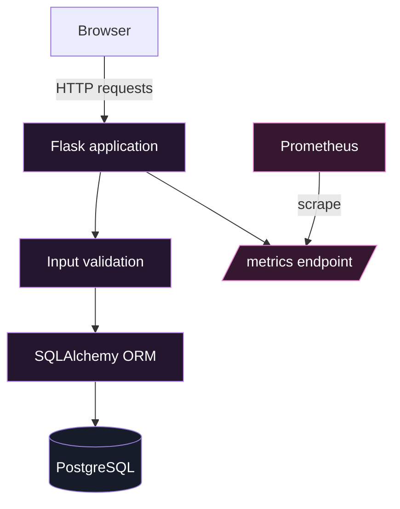

# Daily Tasks — Flask, PostgreSQL & Docker

A small task manager built with Flask and SQLAlchemy. This project demonstrates a containerized Python web application, PostgreSQL persistence, automated tests, CI with GitHub Actions, and Prometheus metrics.


[](https://github.com/johannafoolchand/formation-devops-training/actions/workflows/tests.yml) [](https://github.com/johannafoolchand/formation-devops-training/actions/workflows/cicd.yml)

## Project at a glance

| Area | Implementation |
| --- | --- |
| Backend | Flask application and SQLAlchemy ORM |
| Database | PostgreSQL in Compose; SQLite for local tests |
| Containers | Dockerfile and Docker Compose |
| Quality | Pytest suite and GitHub Actions |
| Observability | Prometheus metrics exposed at `/metrics` |

## Features

- Create and delete tasks
- Input validation (empty values and 200-character limit)
- PostgreSQL persistence with Docker Compose
- SQLite fallback for local development and automated tests
- Prometheus metrics at `/metrics`
- Responsive interface
- Pytest test suite and GitHub Actions CI

## Architecture

The browser interacts with the Flask application. SQLAlchemy handles persistence, while Prometheus can scrape the dedicated metrics endpoint.



## Run with Docker Compose

Requirements: Docker Desktop or Docker Engine with the Compose plugin.

1. Create your local environment file:

   ```bash
   cp .env.example .env
   ```

2. Edit `.env` and set strong, unique values for `POSTGRES_PASSWORD` and `SECRET_KEY`.

3. Build and start the services:

   ```bash
   docker compose up --build -d
   ```

4. Open [http://localhost:5000](http://localhost:5000). Metrics are available at [http://localhost:5000/metrics](http://localhost:5000/metrics).

5. Stop the services:

   ```bash
   docker compose down
   ```

PostgreSQL data is stored in the named `postgres_data` volume and is retained when containers are recreated. To delete the data as well, run `docker compose down -v`.

## Run locally

Python 3.11 or newer is recommended.

```bash
python -m venv .venv
source .venv/bin/activate  # Windows: .venv\Scripts\activate
pip install -r requirements.txt
python main.py
```

Without `DATABASE_URL`, the application uses a local SQLite database. For PostgreSQL, set `DATABASE_URL` to a valid SQLAlchemy PostgreSQL connection string.

## Tests

```bash
pytest -q
```

Tests use an isolated in-memory SQLite database and Flask's test client. They do not require a running PostgreSQL server or Docker.

## Configuration

| Variable | Purpose |
| --- | --- |
| `DATABASE_URL` | SQLAlchemy database connection string |
| `SECRET_KEY` | Flask session signing key |
| `PORT` | HTTP port (default: `5000`) |
| `POSTGRES_DB` | PostgreSQL database name for Compose |
| `POSTGRES_USER` | PostgreSQL user for Compose |
| `POSTGRES_PASSWORD` | PostgreSQL password for Compose |

Never commit your real `.env` file or production secrets.

## Project structure

```text
.
├── .github/workflows/tests.yml
├── main.py
├── requirements.txt
├── Dockerfile
├── docker-compose.yml
├── .env.example
├── templates/
│   ├── index.html
│   ├── 404.html
│   └── styles.css
└── tests/
    └── test_app.py
```

## Next improvements

- Add task editing and completion status
- Add database migrations with Flask-Migrate
- Add authentication if multi-user support is needed
- Add container image publishing and deployment automation
- Add a dedicated Prometheus and Grafana stack

## What this project demonstrates

Python, Flask, SQLAlchemy, PostgreSQL, Docker, Docker Compose, environment-based configuration, automated testing, GitHub Actions, and Prometheus instrumentation.
